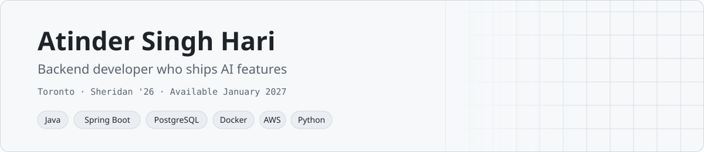

<picture>
  <source media="(prefers-color-scheme: dark)" srcset="assets/banner-dark.svg">
  
</picture>

### Proof

- **Best UI** at Datahon for [Chestify](https://chestify.atinder.dev), a live app that fact-checks short videos
- **Best Use of DigitalOcean** at Hackville for [Gotta Fill 'Em All](https://github.com/atinder-harika/gotta-fill-em-all)
- **3 developer internships:** REST APIs and Python automation at Six Degrees Medical, React at Skill Squirrel, and Angular with Spring Boot at Samskrita Bharati

### Building now

[README Runner](https://github.com/atinder-harika/readme-runner): a Spring Boot platform that safely runs any public repo from its README.

[LinkedIn](https://www.linkedin.com/in/atinder-singh-hari) · [atinder.dev](https://www.atinder.dev) · [X](https://x.com/atinder_harika)
